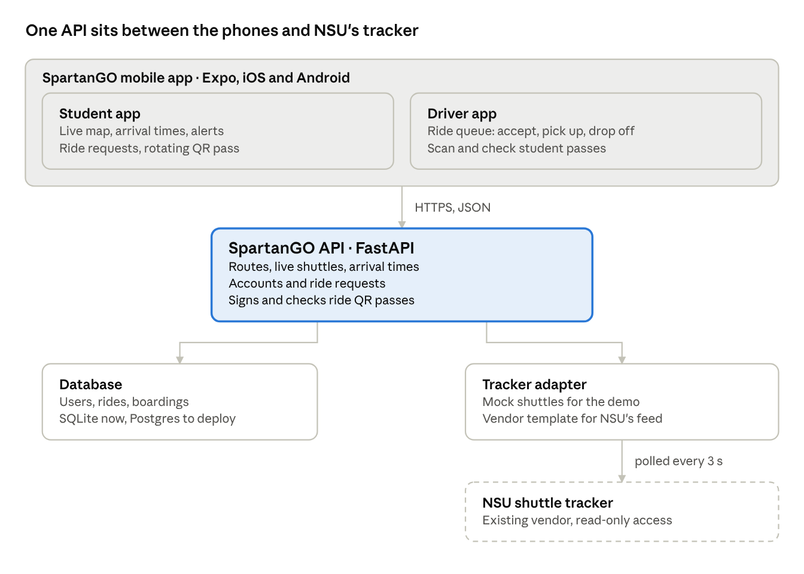
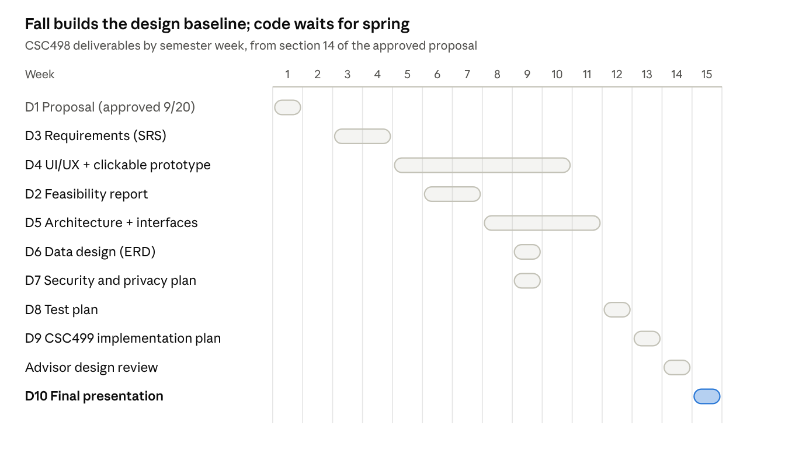

# SpartanGO Project Plan

Last synced from the shared plan doc: Oct 12, 2026 · Koi Williamson

## Overview

SpartanGO is a prototype iOS and Android app that shows NSU students where shuttles are, estimates arrival times, lets them request a ride from a designated stop, and lets a driver check a short-lived QR code at boarding. It is a capstone prototype: the QR code is not an official NSU credential, and any live university data needs separate approval.

This plan follows Dr. Nwosu's approved proposal (signed 09/20/2026). Fall (CSC498) produces the design baseline: requirements, feasibility, wireframes, architecture, data, security and test plans. Spring (CSC499) builds it. No production code is due this fall.

The starter code already written counts as a **feasibility prototype**: disposable code that answers the technical questions in proposal section 10 (location source, ETA method, QR token design, mobile framework, backend). Its results go into the Feasibility Report (D2), and it can serve as the starting skeleton in spring if the design is approved.

## Requirements coverage

The feasibility prototype already shows 7 of the 10 preliminary functional requirements can work. The other 3 (FR-08 degraded service, FR-09 data minimization, FR-10 audit events) are design work for the SRS (D3) and the Security Plan (D7).

| ID | Requirement (short) | Prototype evidence | Still to design in CSC498 |
| --- | --- | --- | --- |
| FR-01 | Student picks an approved pickup stop | Stop chips on Ride screen; server rejects stops not on the route | Official stop list and coordinates from Transportation |
| FR-02 | Submit ride request, see clear status | Pending → accepted → picked up → completed; one open request per student | Confirmation step before submit; cancellation rules |
| FR-03 | Shuttle status and ETA from approved source | Live map and per-stop ETA from simulated shuttles | Approved data source; ETA accuracy claim and how to measure it |
| FR-04 | Alerts for meaningful status changes | Local alert when shuttle is about 3 min away | Event matrix: which changes notify, wording, timing |
| FR-05 | Generate and display QR token | Signed token, rotates every 30 s, no personal data in the QR | Approved prototype identity model |
| FR-06 | Operator validates token | Driver scan screen with valid / invalid result | Show expired as its own state, separate from invalid |
| FR-07 | Reject expired, malformed, invalid tokens | Tested: forged, expired, replayed, malformed all rejected | Write as formal test cases in D8 |
| FR-08 | Clear feedback when services fail | Error text only | Degraded-state screens for no location, no network, no notifications |
| FR-09 | Keep only minimum data | Stores student ID number at signup | Decide if student ID is needed at all; retention rules |
| FR-10 | Log security and workflow events | Boardings table only | Audit event list without unnecessary personal data |

## Architecture

One Expo app serves students and drivers; it talks only to the SpartanGO API, which is the single place that touches NSU's tracker. Swapping the simulated shuttles for the real feed is one Python class.

Stack: Expo (React Native, TypeScript) for the app, FastAPI (Python) for the API, SQLite for development and Postgres once deployed. The dashed box is NSU's existing system; the project only reads from it.

## Workstreams

The proposal names five workstreams. Each needs a primary owner and at least one reviewer. Confirm names with Dr. Nwosu once the technology stack is approved.

| Workstream | CSC498 deliverables owned | CSC499 responsibility | Owner | Reviewer |
| --- | --- | --- | --- | --- |
| Product / Requirements | D1 Proposal, D3 SRS, D9 Implementation Plan | Change control, acceptance checks, demo coordination |  |  |
| Mobile UX / Front End | D4 UI/UX Design Package (wireframes, clickable prototype) | Mobile screens and UI tests |  |  |
| Backend / Data | D5 Architecture, D6 Data Design (ERD, data dictionary) | API, database, ride-request states |  |  |
| Location / Notifications | D2 Feasibility Report (location, ETA, notifications) | Map, ETA and alert implementation |  |  |
| Security / QR / Testing | D7 Security and Privacy Plan, D8 Test Plan | QR verification, security and failure testing |  |  |

D10, the final presentation, belongs to everyone. Working rules: one shared repo for documents and code, every deliverable reviewed by a second person before it goes to the advisor, and architecture decisions written down with the options you rejected.

## Fall timeline

The fall is graded on design readiness, not code: 10 deliverables over 15 weeks, ending in a design baseline that spring builds without re-planning. Weeks come straight from section 14 of the proposal.

| Deliverable | Due (week) | Workstream | Status |
| --- | --- | --- | --- |
| D1 Final CSC498 Proposal | 1 | Product / Requirements | Done |
| D3 Software Requirements Spec | 3–4, traceability in 12 | Product / Requirements |  |
| D4 UI/UX Design Package | Wireframes 5, clickable prototype 10 | Mobile UX |  |
| D2 Background and Feasibility Report | 6–7 | Location / Notifications |  |
| D5 System Architecture Package | 8, interfaces 11 | Backend / Data |  |
| D6 Data Design Package | 9 | Backend / Data |  |
| D7 Security and Privacy Plan | 9 | Security / QR / Testing |  |
| D8 Testing and Evaluation Plan | 12 | Security / QR / Testing |  |
| D9 CSC499 Implementation Plan | 13 | Product / Requirements |  |
| D10 CSC498 Final Presentation | 15 | Everyone |  |

The feasibility prototype gives D2, D5, D6 and D7 a head start: its architecture, data tables and QR design can be written up as findings. Set each status to where the team actually is.

## Questions to ask

The first answer that matters is which tracking vendor NSU's shuttles use and whether the project can get read-only API access; everything about real data depends on it.

**NSU Transportation**

- [ ] Which system tracks the shuttles today (TransLoc, Passio GO, DoubleMap, a fleet GPS)? Who is the contact?
- [ ] Can the project get a read-only API key or data feed for the semester?
- [ ] The official list of routes, stops and schedules, with coordinates.
- [ ] Do riders currently show ID to board? Would drivers try scanning a phone pass in a pilot?
- [ ] Do shuttles take on-demand ride requests today, or only run fixed loops?

**Dr. Nwosu**

- [ ] Final presentation date and what the demo must show live.
- [ ] Does the feasibility prototype count toward D2, and can it become the CSC499 starting skeleton?
- [ ] Due dates for D2 to D10 on the calendar, so the week numbers in the tracker become real dates.
- [ ] Which demo identity model is approved (demo accounts vs. NSU email sign-up), and can the prototype use NSU's name and logo?

## Risks

The biggest risk is not getting tracker access in time; the app is built so the demo still works on simulated shuttles.

| Risk | Fallback |
| --- | --- |
| No API access to NSU's tracker | Demo on the mock provider; show the adapter as the integration point and the vendor template |
| Stop list never arrives | Walk the routes and record stop coordinates on a phone |
| iOS install for testers | Test in Expo Go; build an Android APK for wider testing; iOS TestFlight needs a $99/yr Apple account |
| Schedules don't line up | Friday meetings fixed; GitHub issues as the task list; async updates in the group chat |
| Pass misuse (screenshots, forged codes) | Already handled: 30-second rotation, server-signed codes, one scan per code |
| ETA inaccurate in traffic | Use the vendor's ETA if it has one; otherwise tune average speed from real trips |
| QR pass mistaken for an official NSU ID | Label it on screen as a prototype pass; never call it an ID replacement (proposal section 17) |
| Coding ahead of the approved design | Treat the starter as disposable feasibility evidence; freeze new features until the design review in week 14 |
