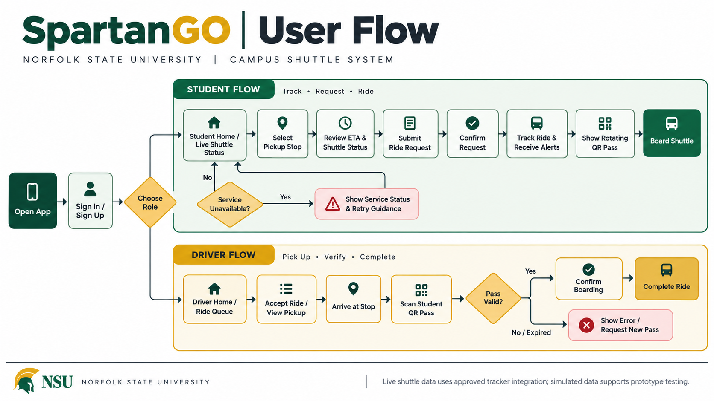

SpartanGO User Flow: Request a Ride

Overview

This user flow describes how an NSU student uses SpartanGO to select a pickup stop, view shuttle information, and request a ride.

## User Flow Diagram

Primary user: NSU student
Goal: Request a shuttle ride from an approved pickup stop.
Entry point: SpartanGO student home screen.

User Flow

Step 1: Open the App

The student opens SpartanGO and signs in.

System response: The app displays the student home screen.

Step 2: View Shuttle Information

The student views the campus map, shuttle locations, and estimated arrival times.

System response: The app displays available shuttle information and route status.

Step 3: Select a Pickup Stop

The student opens the pickup-stop selection screen and chooses an approved stop.

System response: The app confirms the selected pickup stop.

Step 4: Review Ride Details

The student reviews the selected stop and available shuttle information.

System response: The app displays relevant arrival estimates and ride details.

Step 5: Submit the Ride Request

The student selects the option to request a ride.

System response: The app submits the request and displays its status.

Step 6: Receive Request Confirmation

The student views the ride request status.

System response: The request begins in the pending state. The student receives an update when the status changes.

Step 7: Follow Ride Status

The student checks for updates while waiting for the shuttle.

System response: The app communicates supported status changes, including acceptance, pickup, and completion.

Alternate and Error Flows

* No approved pickup stop selected: The student must select an approved stop before submitting the request.
* Request submission fails: The app displays an error message and explains that the request was not successfully submitted.
* Another request is already open: The app prevents the student from creating a second open ride request.
* Shuttle information is unavailable: The app displays a clear service-status message rather than presenting unavailable information as current.
* Request status changes: The app displays the updated status and notifies the student when appropriate.

Flow Summary

Open App → Sign In → View Shuttle Information → Select Pickup Stop → Review Ride Details → Request Ride → View Request Status → Follow Ride Progress

Design Considerations

* Keep the request process simple and easy to navigate.
* Display clear confirmation after the student submits a request.
* Make ride statuses easy to understand.
* Provide meaningful error messages.
* Prevent multiple open requests for the same student.
* Communicate shuttle information accurately and clearly.
